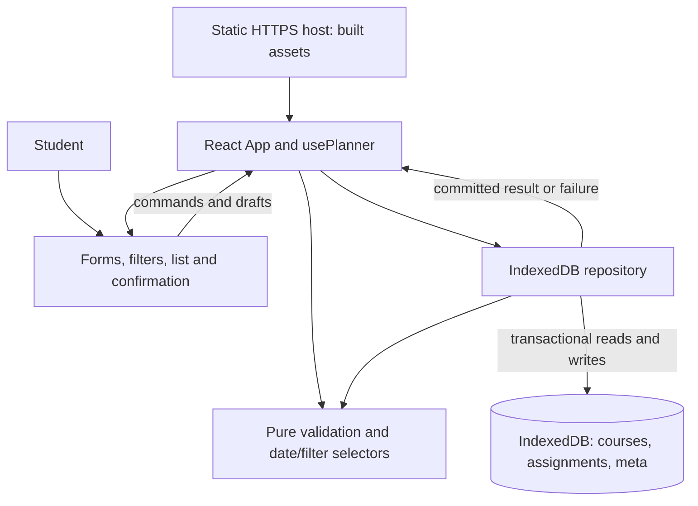

# Alternative Architecture: React and IndexedDB

**Date**: 2026-11-05
**Status**: Architecture proposal for comparison; no implementation or selection decision.
**Inputs**: [Constitution v1.0.0](../.specify/memory/constitution.md),
[feature specification](../specs/001-manage-study-work/spec.md), and
[base architecture](architecture-base.md). Existing planning documents continue to describe the base.

## Scope and architectural decision

Use a small React interface with plain CSS, pure JavaScript domain functions and a native
IndexedDB repository, built with Vite and served by static HTTPS hosting. One student uses one
browser profile/device, normally one active tab. Courses and assignments survive normal app and
browser restarts. No accounts, login, backend, synchronization, reminders, export/import, backup,
service worker or guaranteed offline launch are introduced.

The meaningful difference is component-driven rendering plus asynchronous, record-level,
multi-store transactions. React organizes forms and result rendering; IndexedDB protects related
reads and writes in a transaction without rewriting the full dataset. Neither choice changes the
required student behavior or prevents browser data loss.

## Components and responsibilities

| Component/module | Responsibility |
| --- | --- |
| App | Own committed records, current view/filters and load/write state; compose screens |
| usePlanner hook | Load once, serialize commands, coordinate repository results and reducer updates |
| CoursePanel / CourseForm | List distinct courses, collect drafts, rename, request confirmed deletion |
| AssignmentForm | Controlled draft for course, title, description, date; retain values on failure |
| AssignmentList / AssignmentItem | Display details and textual status; edit, toggle and delete by ID |
| FilterBar | All/upcoming/overdue and course/status selectors; clear filters and refresh |
| ConfirmDialog / StatusMessage | Accessible confirmation, focus restoration, errors and save announcements |
| domain.js / dates.js | Authoritative validation, date-only logic, query predicates and ordering |
| plannerRepository.js | Open/validate database, transaction-scoped commands, reads and error mapping |
| styles.css | Responsive layout, visible focus, contrast and long-text wrapping |

Use React local state and one reducer at the top level; pass props/callbacks. No Redux, router,
server-state library, ORM or IndexedDB wrapper is needed. Repository complexity stays in one
module with small private helpers. React and React DOM are runtime dependencies; Vite and its
React plugin are development dependencies. Pin compatible versions and commit the lockfile if
this alternative is selected. No package or source files are created by this proposal.



Keep committed records separate from drafts. Selectors derive visible assignments during render;
do not store additional overdue flags or copied filtered arrays. This follows React's guidance
on avoiding redundant state and selecting by ID in
[Choosing the State Structure](https://react.dev/learn/choosing-the-state-structure).

## Data model

Database name: `studyplanner-alternative`, initial database version: 1. It is independent of the
base localStorage key and never reads, changes or deletes it. Comparing proposals does not imply
a data migration. Switching a deployed app between storage designs would require a separate,
explicit migration design before claiming continuity of existing records.

| Object store | Key and fields | Constraints |
| --- | --- | --- |
| courses | keyPath id: UUID; name: string; order: integer | Name trimmed, 1–100 grapheme clusters; order unique, positive safe integer |
| assignments | keyPath id: UUID; courseId: UUID; title: string; description: string; dueDate: string; completed: boolean; order: integer | Existing course; trimmed title 1–200 graphemes; description 0–2,000; real date; order unique, positive safe integer |
| meta | keyPath key; one record with key='state', schemaVersion=1, nextCourseOrder, nextAssignmentOrder | Counters positive safe integers greater than existing orders |

IDs are immutable crypto.randomUUID values. Description defaults to an empty string; completed
defaults to false. Duplicate names/titles remain legal, selectable by ID with stable ID suffixes
where needed to distinguish labels. Description whitespace is retained. Use Intl.Segmenter to
count user-perceived characters; native maxlength is not the authoritative limit.

Create a nonunique `byCourseId` index on assignments for course-deletion checks. No date or
completion indexes are necessary at 500 records: read records into memory and use simple selectors.
Booleans are stored values, not IndexedDB index keys. Explicit order fields preserve stable ties
because UUID key iteration does not represent creation order. Allocate and increment the relevant
counter in the same write transaction as insertion. Edits never change order; deletion never
renumbers remaining records. Reject counter overflow without writes.

Startup reads all three stores in one readonly transaction and validates types, IDs, orders,
metadata and all relationships before exposing an editable state. IndexedDB has no foreign-key
constraint; the application must enforce it. Successful fresh creation establishes stores, index
and metadata atomically in the upgrade transaction. Existing databases missing required schema
or metadata are errors, not first-use empty planners.

## Data flow and transaction protocol

1. Startup opens the database and completes any initial creation. A readonly transaction loads a
   consistent dataset. App shows loading, ready or blocked-error state; no writes occur in render.
2. A form keeps its own draft and dispatches a command with immutable target IDs. Validate shape,
   lengths and dates before opening a write transaction; repeat relationship/existence checks
   against records read within that transaction.
3. For simplicity, every mutation uses one readwrite transaction spanning courses, assignments
   and meta. This modest broad scope serializes related mutations and makes referential checks
   and writes atomic. Queue commands and disable repeat submission while pending.
4. Inside the active transaction, read the relevant current records, apply shared rules, then
   issue add/put/delete and counter updates. A missing target or populated-course deletion
   aborts/no-ops with an explanatory result. Use add for creation, and existence-checked put for
   editing so a stale form cannot recreate a deleted assignment.
5. Resolve the command only on transaction complete; request success alone is insufficient.
   On abort/error, publish no success and retain the draft and previous committed UI state.
   Apply the committed delta through the reducer and recompute selectors only after completion.
6. Do not perform network calls, timers, UI prompts or unrelated awaits inside a transaction.
   Schedule dependent requests in active request callbacks, with completion handlers registered
   early, so browser auto-commit cannot invalidate the operation.

IndexedDB transactions commit their changes together or abort them. Completion is the UI's save
boundary; it is not an unconditional guarantee against power loss. These semantics and the
transaction lifecycle are described by the [IndexedDB specification](https://www.w3.org/TR/IndexedDB/).
If a post-commit refresh/render fails, report that the save committed but display needs reload;
do not claim rollback or automatically repeat a create command. User retries after an aborted
write revalidate against current stored records.

React reducers stay pure. Writes occur only in explicit event-driven commands, never effects
that mirror every state change into storage. Startup effects must tolerate development Strict
Mode setup/cleanup: ignore obsolete load results and close obsolete connections; never seed
sample data. Atomic storage protects relationships, but live cross-tab synchronization and
conflict resolution remain outside scope.

## Validation, dates, filtering and deletion

All saved and loaded records pass the same domain rules. Field errors retain drafts, identify
the field and explain corrections; invalid data never partially saves. Use JSX text rendering
and avoid dangerouslySetInnerHTML for student content. Validate supported status values and
record references at the repository write boundary, not merely in controls.

Due dates are canonical YYYY-MM-DD strings, years 0001–9999, validated against Gregorian month
lengths and leap years. Past dates are accepted. Obtain today using local year/month/day getters;
never convert date-only values through UTC timestamps. Upcoming means incomplete and date >=
today, without an upper horizon; overdue means incomplete and date < today. Recompute on view
entry, refresh, filter changes and committed mutations. A refresh control handles overnight pages;
timezone changes do not alter stored dates.

All-assignments is the initial view. Course defaults to all and completion defaults to all. AND
the view predicate, selected course and completion predicate. A completed filter within upcoming
or overdue produces an explicit empty result. Clear filters resets course/status while retaining
the view. Sort by ascending dueDate, English Intl.Collator title order, then ascending stored
order. Completion toggles persist a boolean and immediately change membership after commit.

Deletion requires confirmation. A course with assignments cannot be deleted: direct the student
to move assignments through edit or delete them individually. Within the deletion transaction,
query byCourseId and reject if any assignment exists, even if the UI earlier showed none. Empty
course deletion resets its selected course filter to all. Renaming preserves relationships.
Cancel saves nothing; repeated deletion of a missing ID gives a no-change message and never
selects another record. No cascade deletion or undo is added.

## Failures, recovery and retention

| Situation | Behavior |
| --- | --- |
| No database yet | Create version 1 atomically; show add-course guidance after successful open |
| Valid empty database | Normal empty state, not an error |
| Denied/unavailable IndexedDB or open/read failure | Block editing, show retry guidance; do not pretend empty data was loaded |
| Invalid records, missing stores/meta or orphan references | Preserve database, block writes, explain validation/read failure |
| Quota, request error, abort or clone failure | Abort the whole transaction, retain previous data/draft, show failure and retry |
| Upgrade blocked by another connection | Explain closing other tabs and retrying; do not delete the database |
| versionchange on an open connection | Close connection, block commands, ask for reload to reopen compatible code |
| Newer database than supported | Report incompatible version; never downgrade or recreate it |
| Unexpected connection close | Block mutation and reconnect/revalidate on retry |

If a reload fails after valid data was displayed, label that snapshot stale/read-only. Retrying
load reopens/revalidates without modifying stored records. Never fall back silently to localStorage
or volatile saves. Transaction abort provides rollback, not recovery of physically corrupted or
cleared data. No automatic salvage/reset is attempted. Future version upgrades must be explicit,
transactional and tested against prior fixtures; failed upgrades abort without deleting old data.

Manual troubleshooting reset, only if the student intentionally discards all alternative-app
data: close its tabs, delete only `studyplanner-alternative` through browser developer tools and
reopen. It is destructive, not a recovery method; leave the base key and other origin data intact.
No reset feature or migration is implemented here.

Origin/profile/device boundaries remain the same as the base. Browser quota is finite and
variable; IndexedDB does not guarantee unlimited capacity. Data clearing, private browsing,
eviction, device loss or profile changes can remove records. App records are not uploaded or
encrypted by this design; same-origin scripts and users of the profile may access them. Use no
third-party runtime scripts. A static host cannot restore lost records. Finish saves before normal
closure; pending transactions during shutdown must not be presented as completed saves.

## Testing and acceptance

Use Vitest for pure rules/repository behavior, React Testing Library for interaction and accessible
form behavior, and Playwright for real-browser persistence and transactions. An IndexedDB test
double such as fake-indexeddb can accelerate unit checks, but real-browser tests are authoritative
for transaction scheduling, blocked upgrades and browser quota/access behavior. These are proposed
development tools, not added dependencies in this documentation step.

- Cover course/assignment CRUD, move/rename, duplicate labels, cancellation, stale IDs, blocked
  course deletion, grapheme boundaries, empty descriptions, leap years and local-midnight dates.
- Exercise every view/course/status intersection and sorting ties, completion edits and filter reset.
- Force a failure after one write request succeeds but before transaction completion; verify every
  write/counter change rolls back and no success appears. Check open/read failures, corrupt records,
  unavailable storage, failed upgrades, blocked opens and retries in disposable profiles.
- Check delayed completion and repeated clicks, unmounted components, obsolete startup loads,
  and development Strict Mode do not create duplicate writes or publish stale state.
- Reopen an actual persistent browser profile across ten normal browser restart cycles and compare
  every committed value and deletion (SC-004). A fresh browser context cannot prove retention.
- Test 20 courses/500 assignments: correct results within two seconds in at least 19/20 trials
  (SC-002); exact date/filter fixture results (SC-003). Record device and browser versions.
- Have five unfamiliar students perform SC-001: four must create a course/assignment within two
  minutes and edit date/toggle/delete within two additional minutes without help.
- Manually check all stories by keyboard, semantic labels/headings, visible focus, confirmations
  and focus return, textual status/errors, 4.5:1 text contrast, and 320px width without horizontal
  page scrolling (SC-005). React alone does not establish accessibility.

Core behavioral tests and regression checks must pass before acceptance (SC-006). Use isolated
temporary profiles, not real student data. None of these checks has been executed for an app yet.

## Build and static deployment

If selected for implementation, use a small Vite React project with components/, domain/ and
storage/ directories. Keep CSS plain and all data local. Choose compatible maintained React/Vite
versions and a supported Node LTS runtime; document and lock the exact toolchain before building.
The following are future package-script contracts, not commands run in this documentation step:

```sh
npm ci
npm run dev
npm test
npm run test:browser
npm run build
npm run preview
```

Define dev/build/preview using Vite, test using Vitest and test:browser using Playwright. Build
produces dist/; preview checks that artifact locally and is not a production server. Configure
Vite base for the deployment URL (for example /StudyPlanner/ for a project subpath). These steps
follow the [Vite static deployment guide](https://vite.dev/guide/static-deploy.html).

1. Implement, lock dependencies and run checks; build with npm run build.
2. Smoke-test dist/ through preview using a stable local hostname/port. Do not use file://.
3. Upload only dist/ contents to static HTTPS hosting, or use the host's build command and dist
   output setting. A GitHub Pages build workflow is an optional deployment mechanism; none is
   created here. Do not publish tests, docs, browser profiles or source secrets.
4. Verify asset paths/MIME types, console, CRUD, confirmations, filtering, accessibility and normal
   restart retention at the final production URL; record revision and test results.
5. Keep scheme/host/port stable for updates. Publish assets coherently and retain referenced
   hashed assets long enough for old tabs; reload tabs after updates. Roll back only to a build
   compatible with the current database version; never delete data to make a rollback work.

There is one page and no client router, so no route-rewrite configuration is required. Static
hosting delivers assets, not a Node runtime or database server. Changing from development to
production origin, browser or device does not transfer records. Network is needed to load assets;
offline launch is not promised. Hosting analytics/logs may record requests; app data stays local.

## Comparison with the base

| Dimension | HTML/JavaScript + localStorage base | React + IndexedDB alternative |
| --- | --- | --- |
| UI updates | Explicit DOM rendering/events | Declarative components, controlled drafts, reducer |
| Persistence | One synchronous serialized snapshot | Asynchronous per-record operations in transactions |
| Integrity | Validate candidate, replace one key | Validate records/references within multi-store transaction |
| Ordering | Persisted array order | Explicit order fields and transactional counters |
| Build/dependencies | No runtime packages or build | React runtime, Vite build, more development packages |
| Failure handling | Parse/access/quota failures | Also request/transaction lifecycle, connections and upgrades |
| Maintenance | Fewer concepts; DOM updates need discipline | Reusable UI boundaries; hooks/async coordination need discipline |
| Larger datasets | Rewrites entire snapshot on every save | Updates changed records; selectors still scan modest loaded data |
| Retention | Origin-bound, no backup | Same user-level guarantee and loss limitations |

React can make the repeated course/form/list interactions easier to maintain. IndexedDB makes
relationship-sensitive writes atomic and avoids whole-snapshot serialization. These are relevant
benefits, not evidence that the college fixture requires the added stack. At 500 assignments,
measured performance may be adequate in either design. The alternative adds build configuration,
package maintenance, asynchronous error paths and additional testing. The base remains the
simpler default when the student is unfamiliar with React/IndexedDB.

## Constitution and requirements alignment

| Principle | Evidence and qualification |
| --- | --- |
| I. Simple, Focused Design | Small single-page app; React justified by repeated UI, IndexedDB by transactional record changes; no server/router/global-state framework. Added complexity must earn its maintenance benefit before selection. |
| II. Readable, Maintainable Code | Components have focused responsibilities; shared pure rules; storage lifecycle in one repository; documented setup and failure contracts. |
| III. Accessible Screens | Semantic controlled forms, focus/error handling and explicit manual acceptance checks; framework is not a substitute for verification. |
| IV. Validated Input and Reliable Storage | Shared validation, date-only rules, transactional relationship checks, completion-based save boundary, non-destructive errors and documented limits. |
| V. Tested Core Features | Behavioral, component and browser coverage, restart/failure fixtures, regression requirement and manual acceptance. |

The user explicitly requested this alternative for evaluation. Its dependency justifications are
recorded above; there is no requirement that makes it inherently simpler than the base. Selecting
it must apply the constitution's simplest-sufficient-design rule and record why its maintenance
benefits warrant the extra tooling. This document does not change the selected implementation
plan, claim an approved exception, or weaken any principle.

| Requirements | Design coverage |
| --- | --- |
| FR-001–FR-004 | Course/assignment components, validated records, confirmed deletion, required fields and limits |
| FR-005–FR-009 | Date-only selectors, boolean status, all/upcoming/overdue views, intersecting filters, stable order and refreshed lists |
| FR-010–FR-012 | Shared validation and transactional writes, restart retention, rollback and visible read/write failures |
| FR-013–FR-014 | Accessible controls/layout acceptance, explicit profile/device retention notice, no accounts/sync |
| SC-001–SC-006 | Same usability, performance, correctness, retention, accessibility and regression acceptance thresholds |

Assumptions remain those in the specification: current browsers supporting React, IndexedDB,
Intl.Segmenter and crypto.randomUUID; standard storage-enabled profile; English title ordering;
date-only tasks and no concurrent-tab conflict resolution. No new product requirements or
unresolved user choices are introduced. Base and planning documents remain the comparison baseline.
