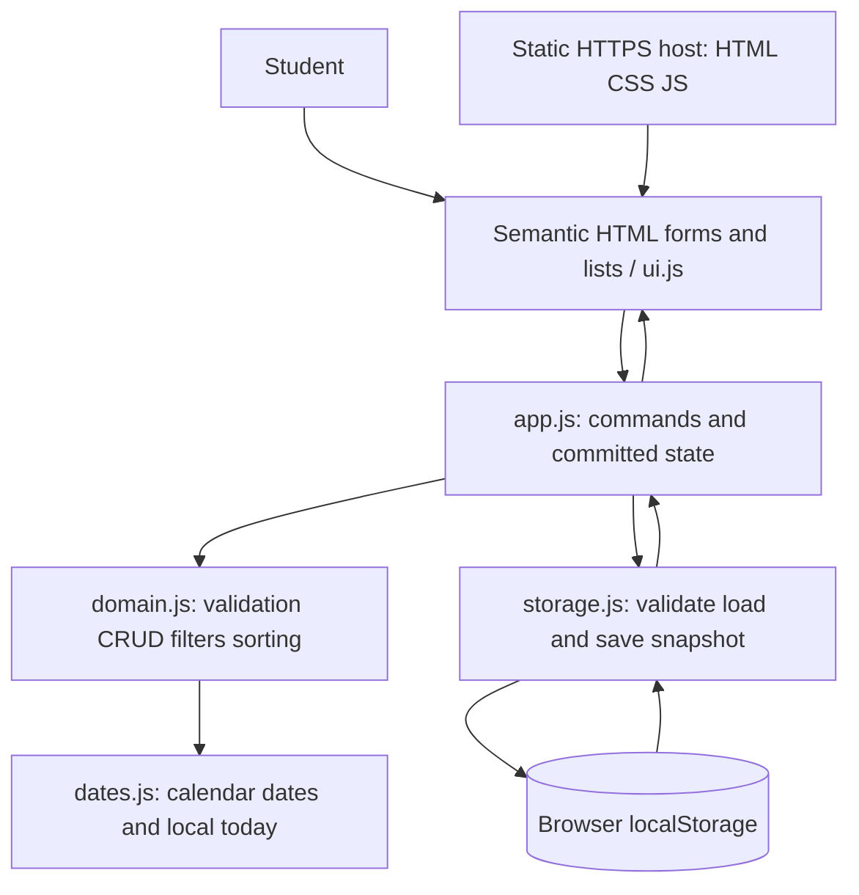

# Final Architecture: StudyPlanner

Date: 2026-11-05. Selected base, consolidated after review; no application implementation or deployment
has occurred. Governing inputs: [constitution](../.specify/memory/constitution.md),
[specification](../specs/001-manage-study-work/spec.md), and its requirements checklist.

The [student decision](architecture-decision.md) selects this architecture. The original
[base](architecture-base.md), [alternative](architecture-alternative.md) and [review](architecture-review.md)
remain unmodified historical evidence. Detailed shared rules are in [final design](design-final.md)
and the [selected plan](../specs/001-manage-study-work/plan.md). Deployment analysis/instructions
are required; actual hosting/publication is outside this documentation exercise.

## Scope and architecture

One student uses the same browser profile and device. Static HTML, CSS and native JavaScript
modules run in the browser; localStorage retains saved data through normal restarts. The static
host delivers assets only and never receives planner records. No login, server, synchronization,
notifications, backup, or service worker is required.

| Component | Responsibility |
| --- | --- |
| index.html / styles.css | Landmarks, labels, responsive layout, visible focus, contrast |
| ui.js | Read drafts, dispatch actions, render text safely, show errors/empty states, restore focus |
| app.js | Own committed snapshot and transient filters; coordinate commands and successful saves |
| domain.js | Authoritative field/relationship checks, immutable candidate changes, selectors |
| dates.js | Validate real calendar dates; obtain local today without UTC conversions |
| storage.js | Guard storage access, JSON parsing, version/shape checks; single-key writes |

These are module boundaries within one app. There is no dependency-injection framework or API
server. Storage can accept a small Storage-compatible test double to exercise faults.

## Models and persistence format

Key: `studyplanner:data`. Value: JSON object with `schemaVersion: 1`, `courses: []`, and
`assignments: []`. Detailed schema: [data model](../specs/001-manage-study-work/data-model.md).

Course: immutable UUID `id`, trimmed `name` (1–100 user-perceived characters).
Assignment: immutable UUID `id`, existing `courseId`, trimmed `title` (1–200), `description`
(string, empty allowed, at most 2,000), `dueDate` (`YYYY-MM-DD`), and boolean `completed`.
Array insertion order is stable and preserved in storage. Duplicate names/titles are allowed;
show course name plus a stable ID suffix where duplicates need distinguishing.

## Data flow and commit boundary

1. Startup reads the storage key in a guarded call. Absence means a new empty planner in memory;
   no automatic write is needed. Existing data must parse and pass the complete schema and
   relationship validation before becoming the committed state.
2. UI holds drafts separately. A command supplies an entity ID and input to application logic.
3. Rules check current IDs, trim names/titles, validate fields and create a candidate snapshot.
   Course rename preserves IDs; assignment move validates its new course; completion changes
   only the boolean. No state or DOM success is published yet.
4. Validate the whole candidate, serialize it, and replace the one storage key with one setItem.
   Only after that succeeds does app.js replace committed state, rerun selectors, render results,
   announce success and clear the draft. Never split courses and assignments into separate keys.
   If rendering fails after setItem succeeds, the candidate remains committed. Report that data
   was saved and the display needs refresh; block mutations until refresh/reload. Do not claim
   rollback or automatically repeat creation. Use separate write and display error boundaries.
5. Before storage success, invalid data or failed serialization/write leaves the prior committed snapshot and stored
   value intact; preserve the draft and show correction or retry guidance. No optimistic success.

A single-key write avoids partial course/assignment commits; it is not a disk-backup or crash
recovery guarantee. Multiple tabs can overwrite one another; simultaneous editing is outside scope.

## Rules, deadlines, and queries

Count user-perceived characters with Intl.Segmenter grapheme segmentation; HTML length controls
are supplementary, not the authoritative limit. Validate types, unique IDs, schema version,
actual calendar dates and course references on load and before every save. Render user strings
with textContent, never interpolate them as executable HTML.

Use date input for entry, but independently check four-digit years 0001–9999, month lengths and
Gregorian leap years. Store canonical date strings; never parse them through UTC Date conversion.
Obtain today using local year/month/day getters. Canonical date strings compare chronologically.
Upcoming: `!completed && dueDate >= today`; overdue: `!completed && dueDate < today`.
Recompute on view entry/refresh, filter changes and saved mutations; a visible refresh control
handles a page left open over midnight. No minute timer is necessary.

Combine view predicate, selected course, and selected completion by AND. Initial view is all
assignments/all courses/all states. Completed filtering in upcoming or overdue legitimately
returns no matches. Sort ascending date, then Intl.Collator('en') title comparison, then original
array position for ties. Clear filters resets both filters only. Delete of a selected empty
course resets course filtering to all. Filter/view state need not persist.

Deletion always asks for confirmation. A populated course cannot be deleted: explain moving
assignments using edit or deleting them individually first. Recheck at submission, not just when
opening the prompt. Cancel never saves. Repeated/stale deletes do not remove other records;
missing IDs produce an explanatory no-change result.

## Storage failures, reset, and retention

| Condition | Required behavior |
| --- | --- |
| Missing key | Empty planner with add-course guidance; save normally on first mutation |
| Invalid JSON or schema, duplicate IDs, orphan references | Show data-read error; block mutations; preserve raw value |
| Newer/unsupported schema version | Explain unsupported data version; block writes; no automatic downgrade |
| Getter/getItem throws or storage denied | Show access failure and retry; do not substitute a writable empty planner |
| setItem/serialization fails or quota exceeded | Keep old saved/committed state and draft; show failed save and retry guidance |
| Retry load | Re-read and validate without deleting or rewriting anything |

On initial load failure, show no fabricated course/assignment list. If a later explicit reload
fails, retain last known state read-only and label it unrefreshed. Retrying a failed write validates
its command again against current committed state. Do not fall back to volatile 'successful' saves.

No automatic reset, salvage, migration, or recovery from corrupted data. Version 1 is the only
supported schema; any future migration needs an explicit tested design before release. For a
student who deliberately wants a fresh planner, documented manual reset is removing only
`studyplanner:data` in browser developer tools and reloading; this permanently discards its data.
Reload is required after manual clearing; a missing key on reload produces an empty planner.
An open page can retain old state. Concurrent editing and developer-tools storage changes during
use are outside normal use. Do not clear all origin storage. This is not a new reset feature.

The browser's quota is finite and environment-dependent; catch quota failures instead of assuming
a guaranteed capacity. Validate the 20-course/500-assignment demonstration fixture. No artificial
record-count limit is introduced. Data is per scheme/host/port, not URL path; apps on the same
origin must not reuse this key. Normal restart retention requires a standard profile permitting
storage. Clearing data, eviction, private browsing, device loss and profile changes can remove it.
Data is unencrypted and accessible to scripts on the origin and users of the same profile.

## Accessible interface

Use semantic headings, lists, buttons, labels and native form controls. Maintain keyboard order,
visible focus and text-based completion/error indicators. Associate field errors with inputs and
focus the first invalid field; announce save failures/results through an appropriate live region.
Confirmation must be keyboard accessible and return focus to a logical control when canceled or
finished. Duplicate records need distinguishable accessible labels. Wrap long text, retain actions
at 320 CSS pixels without horizontal page scrolling, and meet 4.5:1 normal-text contrast.

## Verification approach

Node's built-in test runner checks observable domain behavior: CRUD, grapheme boundaries,
relationships, leap days, local-date fixtures, completion, all view/filter intersections and stable
ordering. Adapter tests inject missing/invalid/unsupported data, denied access, serialization and
quota/write failures, verifying no partial commits or false success. Test user text as text.

A targeted browser test must inject rendering failure after a successful save and verify saved
data survives reload, no duplicate creation occurs and refresh guidance appears.
Playwright exercises all four stories in isolated browser contexts at a stable HTTP origin,
including course deletion blocking, drafts/errors/cancel, no-course guidance, and filter updates.
Persistence acceptance closes/reopens pages and uses the same persistent browser profile across
actual browser restarts for ten cycles; a new isolated context is not a retention test.
Use separate temporary profiles and never reset a student's real data. Run Chromium automatically;
smoke-check supported browsers and record versions. Measure 19/20 two-second trials with 20
courses/500 assignments. Manually verify keyboard, 320px layout, contrast and SC-001 with five
students. Require a regression test for a core bug fix. No tests are implemented in this phase.

## Deployment analysis and future instructions

The following steps are required documentation, not authorization to publish in this exercise.

1. Implement and validate the planned `web/` tree; no bundle/build is required. Use relative
   asset/module URLs so subdirectory hosting works; avoid client-side routes requiring rewrites.
2. Serve `web/` locally over HTTP at a stable port; do not use file:// as the persistence baseline.
3. After checks pass, copy only `web/` contents to an approved static host's document root. Enable
   HTTPS and JavaScript MIME types; exclude tests, specs, local browser profiles and private data.
4. GitHub Pages is one optional example: publish a dedicated static branch with `web/` contents
   at its root using Settings > Pages > Deploy from a branch. Do not publish the repository's
   documentation folder as the application. No hosting configuration or publication occurs now.
5. At the final URL, verify relative assets, no console errors, CRUD, filter behavior, keyboard
   use and close/reopen retention on the same origin/profile. Record deployed revision and URL.
6. For updates, replace static assets coherently and smoke-test schema compatibility. Keep origin
   stable: moving from localhost, HTTP to HTTPS, another port/domain or browser does not transfer data.
   Roll back assets only when their schema compatibility is known; never clear storage on deploy.

Static hosting cannot provide account recovery or shared data. Network is needed to load assets;
cache-only offline startup is not promised. The host may log asset requests, but app code does not
upload records. Avoid third-party scripts. See [GitHub publishing documentation](https://docs.github.com/en/pages/getting-started-with-github-pages/configuring-a-publishing-source-for-your-github-pages-site).

## Tradeoffs and assumptions

Native modules minimize setup and dependencies but require deliberate UI rendering and state
management. localStorage is easy to inspect and adequate for a small fixture; synchronous whole-
snapshot saves and finite quota make it unsuitable for large data or concurrent writers. IndexedDB
would add asynchronous complexity; a server/database adds deployment/authentication beyond scope.
Blocking populated-course deletion reduces accidental loss but requires additional student steps.
Date-only deadlines avoid timezone conversions but do not express timed submissions. No backups
means browser data loss cannot be repaired by this architecture. These limits are accepted for
the confirmed college-project scope; an alternative architecture can compare them explicitly.

## Runtime and evidence status

Runtime requires native ES modules, DOM, JSON, localStorage, Intl.Segmenter, Intl.Collator and
crypto.randomUUID over HTTPS (localhost for development). Target desktop Chrome/Edge/Firefox/
Safari with these features, JavaScript and storage enabled in a normal profile. Fail visibly if
required capabilities are absent; do not silently weaken validation or persistence.

Node 24 with npm is the proposed development-only baseline; Node is not required on the host or
student device. Exact versions, demonstration OS/device/browser, test-tool/static-server versions
and compatibility verification are pending in [quickstart](../specs/001-manage-study-work/quickstart.md).
All application tests, performance, accessibility, usability and restart measurements remain
pending. Completed documentation checks do not establish SC-001–SC-006 acceptance.

The design satisfies the constitution through a small dependency-free runtime, readable module
boundaries, explicit accessibility acceptance, authoritative validation and a reliable save boundary
within documented storage limits. No governance exception is required. FR-001–FR-004 map to CRUD
and models; FR-005–FR-009 to dates/selectors; FR-010–FR-012 to validation/storage/failures;
FR-013–FR-014 to accessibility and retention notice. All success criteria remain acceptance targets.
